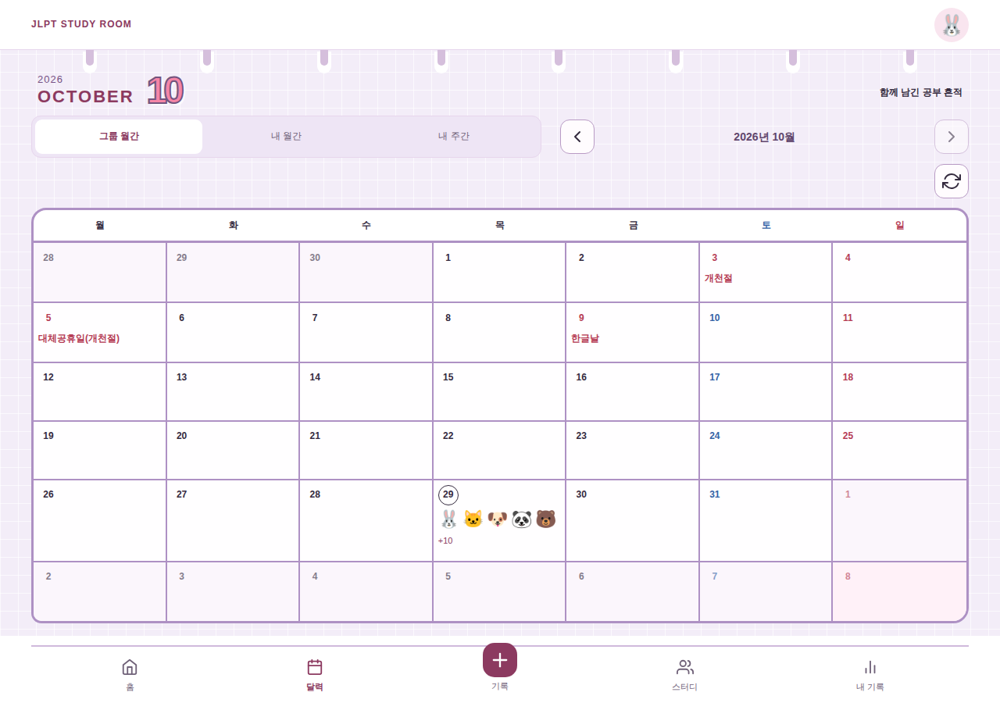

# JLPT STUDY ROOM

함께 공부하고, 하루하루 기록하는 JLPT 스터디 웹앱입니다.
공부 시간과 내용을 달력으로 공유하고, 주간·월간 통계로 나의 학습을 돌아볼 수 있습니다.

## 배포 링크

| 구분          | 바로가기                                                         |
| ------------- | ---------------------------------------------------------------- |
| 사용자 페이지 | [공부방 입장하기](https://jlpt-study-gamma.vercel.app/)          |
| 관리자 페이지 | [관리자 로그인](https://jlpt-study-gamma.vercel.app/admin/login) |

## 화면 미리보기

**그룹 월간 달력 · PC**



화면은 예시 데이터로 구성한 실제 앱 캡처입니다.

## 주요 기능

| 영역        | 제공 기능                                                             |
| ----------- | --------------------------------------------------------------------- |
| 로그인·설정 | 닉네임과 간편 비밀번호로 가입·로그인, 비밀번호·대표 이모지 변경       |
| 공부 기록   | 공부 종류·시간·공부량·메모 입력, 내 기록 수정·삭제                    |
| 달력        | 그룹 월간·내 월간·내 주간 보기, 날짜별 기록과 한국 공휴일 표시        |
| 스터디·통계 | 멤버별 주간 공부 현황, 내 월간 합계·평균·최장 공부 시간과 종류별 통계 |
| 관리자      | 공부 종류 추가·수정·삭제, 회원 내보내기, 간편 비밀번호 초기화         |

## 기술 스택

| 구분            | 사용 기술                                       |
| --------------- | ----------------------------------------------- |
| 언어·프레임워크 | TypeScript, Next.js 16, React 19                |
| 스타일·UI       | CSS Modules, CSS 변수, React Icons, SweetAlert2 |
| 서버 상태·API   | TanStack Query, Next.js Route Handlers          |
| 데이터베이스    | Supabase PostgreSQL                             |
| 외부 연동       | 공공데이터포털 특일 정보 API                    |
| 검증·배포       | Playwright, GitHub Actions, Vercel              |

## 폴더 구조

현재 구현된 주요 폴더입니다.

```text
src/
├── app/          # 페이지·레이아웃·API
├── features/     # 인증·기록·달력·스터디·통계·관리자 기능
├── components/   # 공통 UI·화면 레이아웃
├── lib/          # 공통 유틸리티·공유 메타데이터
├── server/       # 서버 인증·데이터 조회·저장
└── styles/       # 공통 스타일·색상 토큰
public/           # 공유 이미지
tests/            # 기능·화면·DB 검증
docs/             # 설계·결정 기록·화면 이미지
```
